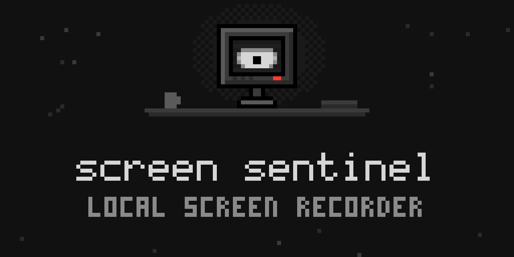
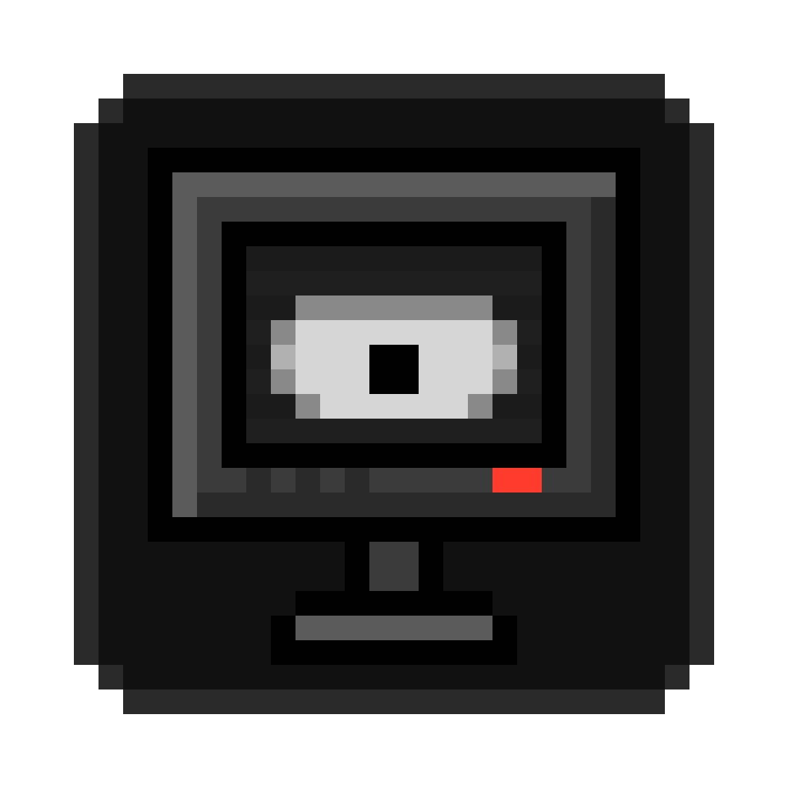

<p align="center">
  
</p>

<p align="center">
  
</p>

<h1 align="center">Screen Sentinel</h1>

<p align="center">A local index of what you see on your screen, for AI agents to query.</p>

## What it does

Screen Sentinel records your screen on macOS. It captures the accessibility
tree of the focused app and uses OCR when no tree is available. It stores the
result in a local SQLite database with full-text search. A REST API and an MCP
server let AI agents search that history.

All data stays on your machine.

## Where it keeps things

| Item | Value |
| --- | --- |
| Data directory | `~/.screen-sentinel` |
| REST API | `http://localhost:3130` |
| MCP HTTP server | `http://localhost:3131` |
| URL scheme | `screen-sentinel://` |
| Bundle identifier | `io.github.samuel-harris.screen-sentinel` |

These values differ from upstream's, so Screen Sentinel and an upstream install
can run on the same Mac without sharing data, ports or permissions.

## Build and run

See [CONTRIBUTING.md](CONTRIBUTING.md) for the full set-up. In short:

```bash
cargo build --release -p screen-sentinel-engine
./target/release/screen-sentinel record
```

Then search what you saw:

```bash
curl "http://localhost:3130/search?q=meeting+notes&limit=10"
```

## Provenance

Screen Sentinel is built from screenpipe 0.4.15, imported at
[`b7f3f08`](https://github.com/Samuel-Harris/screen-sentinel/commit/b7f3f08267fec5fa36d444d688288b009425545e).
[`feature-map/`](feature-map/README.md) records every change made since.

These dependencies still come from upstream, under upstream's names:

- `github.com/screenpipe/opf-rs`
- `github.com/screenpipe/rusty-tesseract`
- `github.com/screenpipe/sck-rs`
- `huggingface.co/screenpipe/pii-text-redactor`
- `huggingface.co/screenpipe/pii-image-redactor`

## License

MIT. See [LICENSE.md](LICENSE.md).
